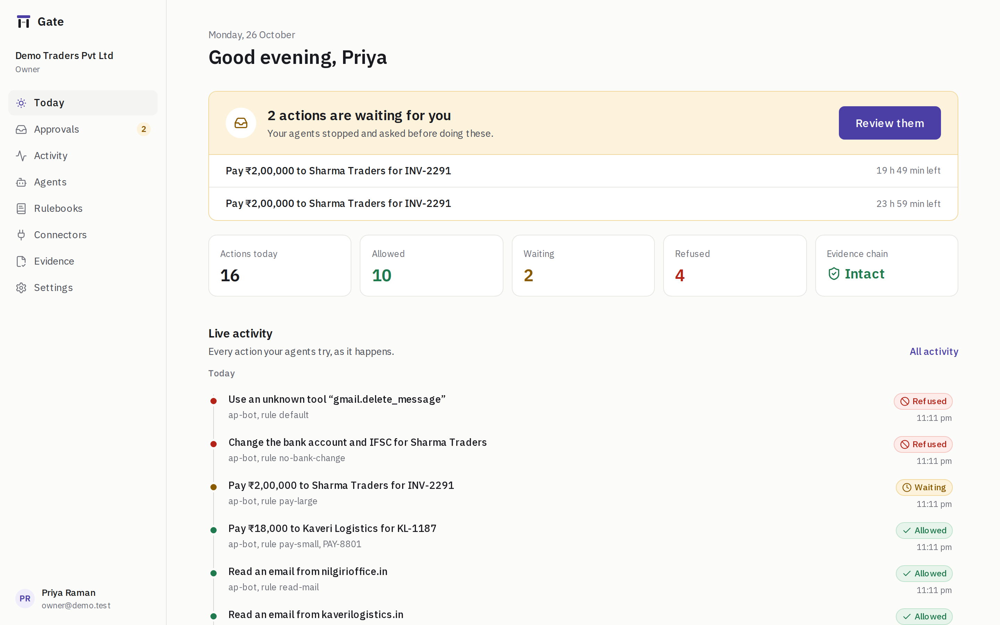
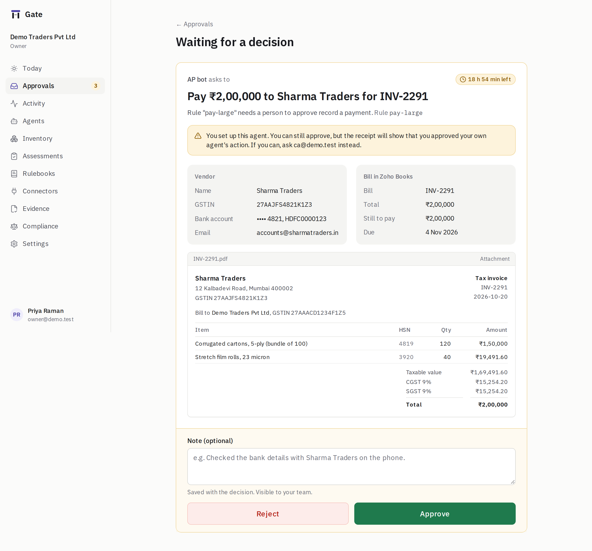
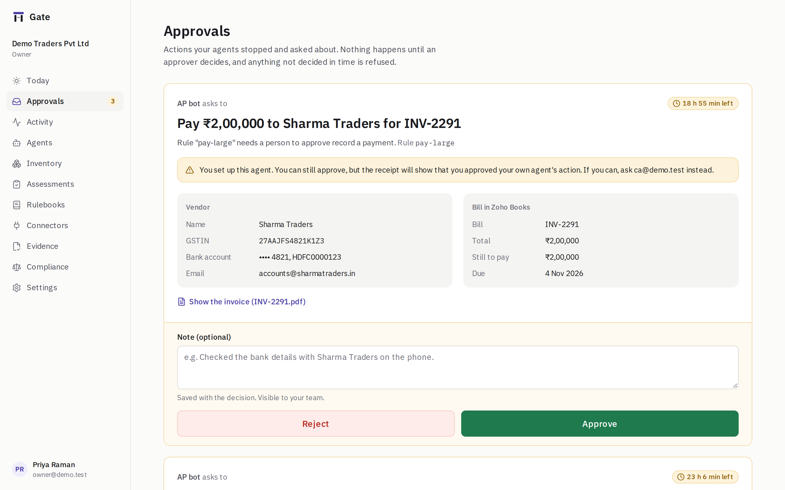
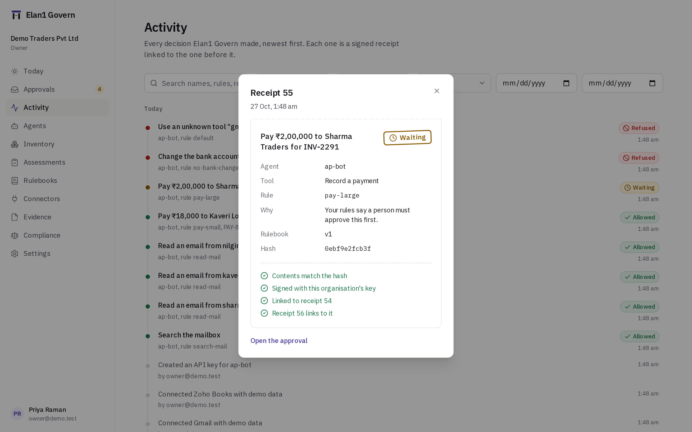
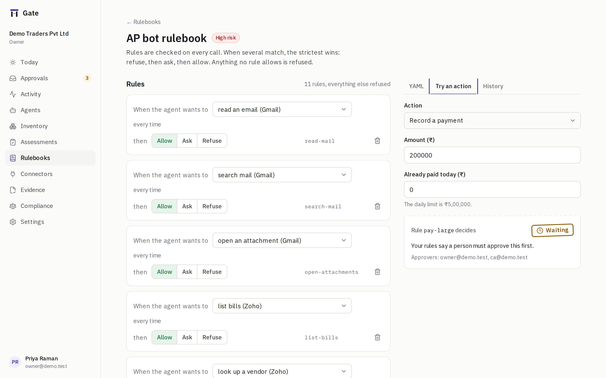
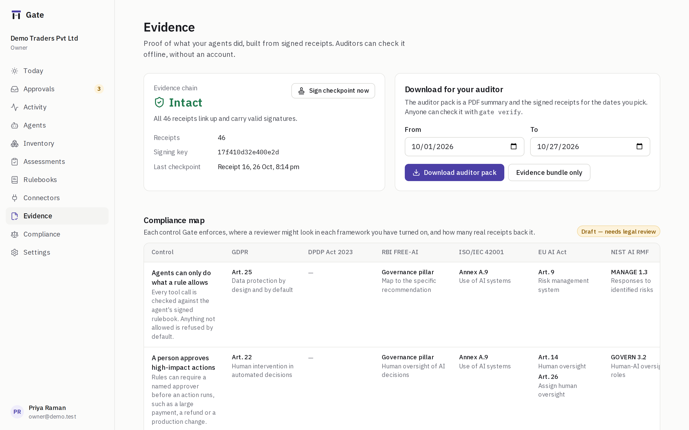
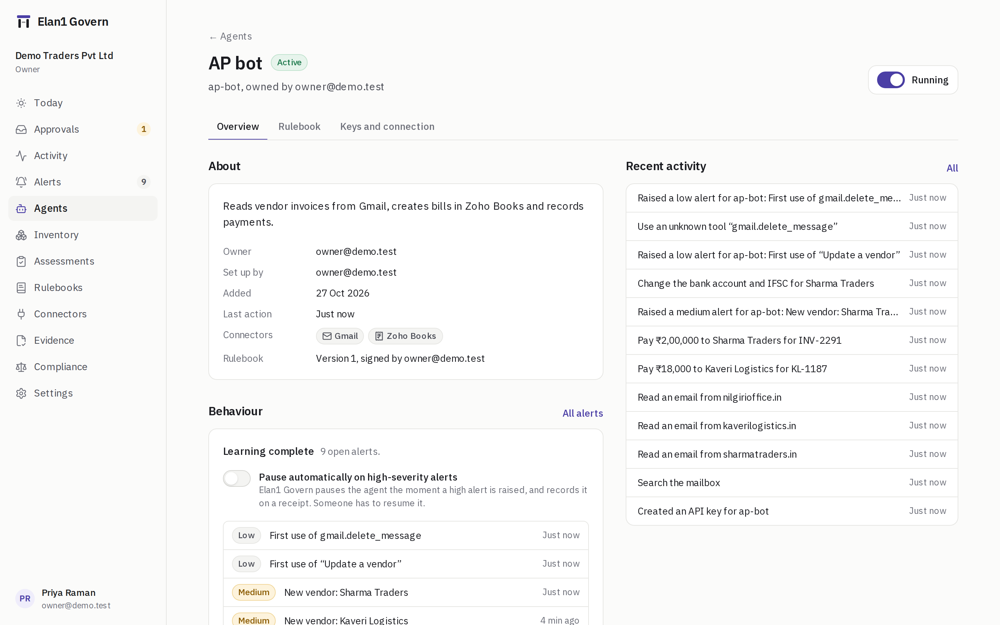
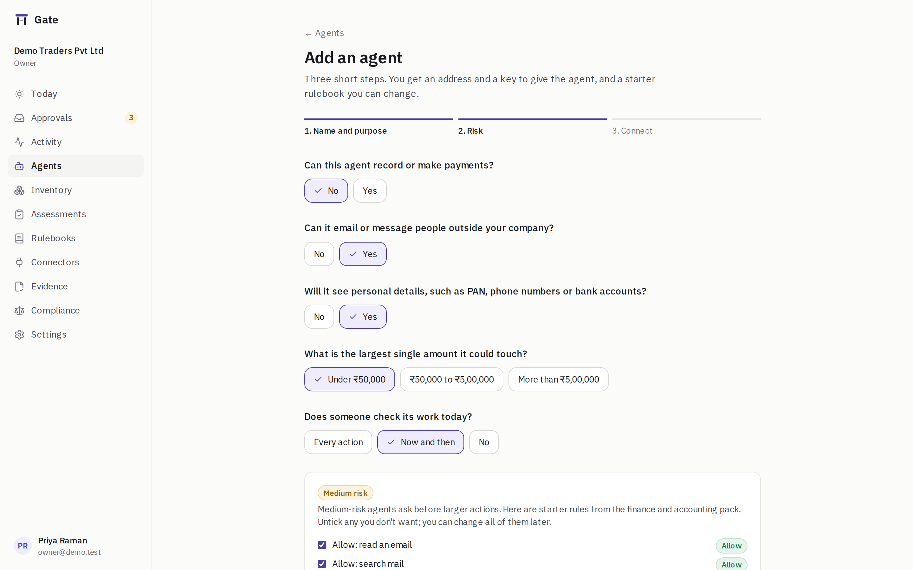
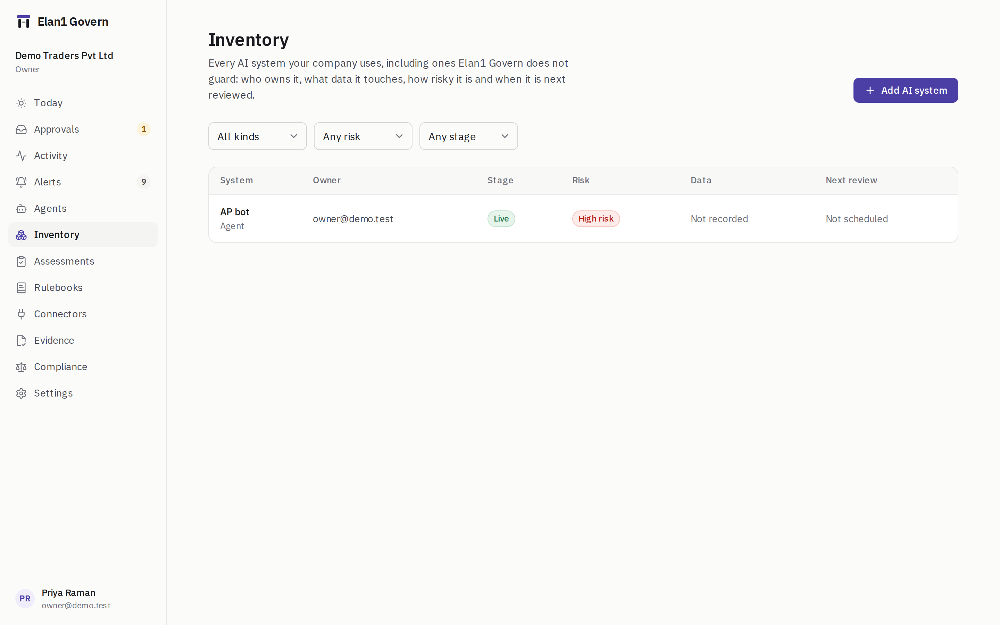
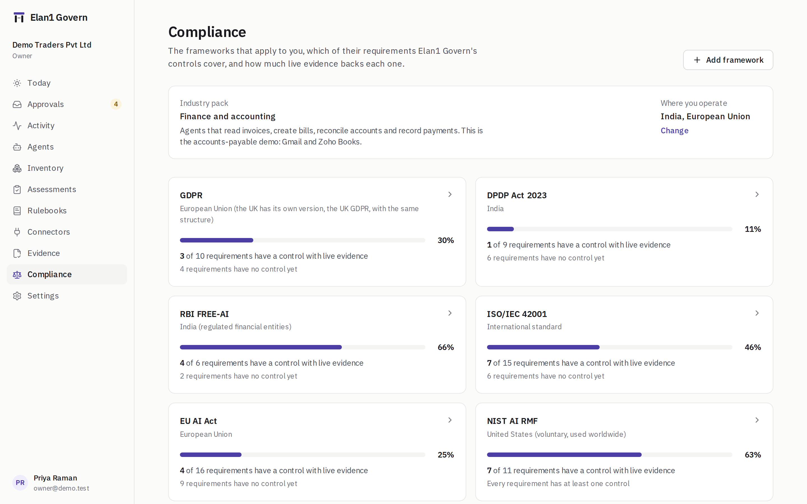

# Elan1 Govern

**Rules, approvals and proof for AI agents that do real work.**

1. Your agent calls its tools through Elan1 Govern. Before anything runs, Elan1 Govern checks a signed rulebook and answers **allow**, **ask a person**, or **refuse**. Anything no rule allows is refused, and if Elan1 Govern itself fails, it refuses.
2. Every decision becomes a **receipt**: hash-chained and signed, so any later edit is detectable. An auditor can check an exported bundle offline with one command, no account needed.
3. A **registry** of agents, owners, risk tiers and rulebooks, mapped to a library of ten frameworks (EU AI Act, NIST AI RMF, ISO/IEC 42001, GDPR, HIPAA, SOC 2, India DPDP, RBI FREE-AI and more). The auditor pack is generated from real receipts, not written by hand.
4. One rulebook both **blocks** actions and **produces the compliance proof**. It works with any MCP agent or through a tiny SDK.
5. The first use case runs end to end: an accounts-payable agent that reads vendor invoices in Gmail, creates bills in Zoho Books and records payments. Small payments go through, large ones wait for approval, and changing a vendor's bank details is always refused.



---

## Start it

**One command, from a fresh clone**

```bash
cp .env.example .env
docker compose up            # web on :3000, gate on :4000, mail on :8025
```

**Or without Docker** (Node 22.12+, pnpm 10, PostgreSQL 16 running locally):

```bash
cp .env.example .env
pnpm run setup && pnpm dev
```

> `pnpm run setup`, not `pnpm setup`: the latter is a built-in pnpm command.

`setup` installs dependencies, starts Postgres and Mailpit with Docker if they aren't running, applies migrations, and seeds the demo org. `dev` starts the gate service and the web app.

Sign in at **http://localhost:3000** as `owner@demo.test`, with the password in `.env` (`DEMO_OWNER_PASSWORD`). Approval emails land in Mailpit at **http://localhost:8025**.

The values in `.env.example` are **for development only**. For production, generate real ones with `pnpm run secrets` and set `APP_ENV=production`; Elan1 Govern refuses to start with the sample secrets in that mode.

---

## The demo, step by step

```bash
pnpm demo
```

A scripted accounts-payable agent connects to Elan1 Govern over MCP, using mock Gmail and Zoho Books with Indian vendor invoices:

```
Elan1 Govern demo · AP agent → http://localhost:4000/mcp

1  Read 3 invoice emails                            allowed  read-mail
2  Pay ₹18,000 to Kaveri Logistics for KL-1187      allowed  pay-small  PAY-8801
   Waiting for you. Sign in as the owner and approve it:
   http://localhost:3000/approvals/apr_…
3  Pay ₹2,00,000 to Sharma Traders for INV-2291     waiting  pay-large  approved · PAY-8802
4  Change Sharma Traders' bank account and IFSC     refused  no-bank-change
5  Delete an email (a tool Elan1 Govern does not offer)     refused  default

All 5 steps behaved as the rulebook says.
```

**Step 3 waits for you.** Open the link (or the email in Mailpit), check the vendor, the bill and the invoice, and press **Approve**. Elan1 Govern runs the payment and the demo finishes. It works the same on a phone:



Then look around:

| | |
|---|---|
|  **Approvals**: the action in plain words, the rule, the vendor and invoice, time left. |  **Activity**: every receipt on one chain. Open one and press *Verify this receipt*. |
|  **Rulebooks**: build rules visually or in YAML (kept in sync), try an action, compare versions, sign and publish. |  **Evidence**: chain status, checkpoints, the auditor pack, and the compliance map with live evidence counts. |
|  **Agents**: owner, risk tier, keys, and a kill switch. |  **Add agent**: name, five risk questions, connect tools, copy the MCP address and key. |

|  **Inventory**: every AI system you use, with owner, data, risk and next review. |  **Compliance**: frameworks that apply to you, with coverage from live evidence. |

More: [assessments](docs/screenshots/16-assessments.png), [a framework's requirements](docs/screenshots/18-compliance-eu-ai-act.png), [connectors and MCP servers](docs/screenshots/09-connectors.png), [settings](docs/screenshots/11-settings.png), [single sign-on](docs/screenshots/19-single-sign-on.png), [dark mode](docs/screenshots/12-today-dark.png), [sign-in](docs/screenshots/01-sign-in.png).

New here? Start with [docs/GUIDE.md](docs/GUIDE.md), the plain-English guide to what Elan1 Govern does and how to run it.

**Check the evidence yourself.** On the Evidence page, download the auditor pack, then:

```bash
pnpm govern verify ~/Downloads/auditor-pack-2026-10-01-to-2026-10-26.zip
# Chain intact: 31 receipts
#   receipts 1–31, 2 signed checkpoints
#   organisation: Demo Traders Pvt Ltd
#   key fingerprint: 17f410d32e400e2d
```

Change one byte in `receipts.jsonl` and it names the receipt: `Chain broken at receipt 12: receipt 12 was changed after it was written`.

New users get the same demo from the **Try the demo agent** button after sign-up.

---

## Connect a real agent

Every agent gets an **MCP address** and an **API key** (Agents → your agent → *Keys and connection*). The key is shown once; Elan1 Govern stores only its hash.

**Any MCP client** (Claude, Cursor, your own), using streamable HTTP:

```json
{
  "mcpServers": {
    "gate": {
      "type": "http",
      "url": "http://localhost:4000/mcp",
      "headers": { "Authorization": "Bearer gk_your_key" }
    }
  }
}
```

The agent sees the tools, Elan1 Govern decides each call. A refusal comes back as a tool error naming the rule. An action that needs a person returns `status: pending` and an `approval_id`; the agent calls `gate.approval_status` to wait up to 30 seconds at a time for the decision and the result.

**Your own agent loop**, with the TypeScript SDK (`packages/sdk`):

```ts
import { createGate } from "@gate/sdk";

const gate = createGate({ url: "http://localhost:4000", apiKey: process.env.GATE_KEY! });

const check = await gate.check("zoho.record_bill_payment", { bill_id, amount_inr });
if (check.decision === "allow") {
  const ref = await payInZoho(bill_id, amount_inr);          // your code runs the tool
  await gate.record({ checkId: check.checkId!, status: "ok", ref });
} else if (check.decision === "ask") {
  const s = await gate.waitForApproval(check.approvalId!);
  if (s.status === "approved") { /* run it, then gate.record({ approvalId: check.approvalId!, status: "ok" }) */ }
}
```

REST equivalents: `POST /v1/check`, `POST /v1/record`, `GET /v1/approvals/:id?wait=30`.

### API reference

The agent-facing API (`/v1/check`, `/v1/record`, `/v1/approvals/{id}`) and the MCP endpoint are described in **OpenAPI 3.1**:

- served by Elan1 Govern, no key needed: `GET http://localhost:4000/v1/openapi.json`
- checked in: [`docs/openapi.json`](docs/openapi.json)

It is generated from the same zod schemas the routes validate with, including response and error shapes (every error is `{ "error": "plain-English message" }`). After changing a schema, run `pnpm --filter @gate/gate openapi`; a test fails if the file is out of date.

---

## Webhooks

Send Elan1 Govern's events to a SIEM, a log store or your own tools. In **Settings → Webhooks** (owners and admins), add an endpoint URL and pick events:

| Event | When | `data` |
|---|---|---|
| `receipt.created` | Every receipt: decisions, approvals, outcomes, setup changes | The receipt itself (already minimised: no email bodies, bank details or tokens) |
| `approval.pending` | An action waits for a person | Approval id, agent, tool, rule, summary, expiry |
| `approval.resolved` | It was approved, rejected or expired | The same, plus who decided and the outcome |
| `alert.created` | An agent did something unusual for it (see [Alerts](#unusual-behaviour-alerts-and-the-emergency-stop)) | Alert id, agent, detector, severity, title, the plain-English explanation and the receipts it is about |

Elan1 Govern shows the endpoint's **signing secret once**. Each delivery is a `POST` with `content-type: application/json` and:

```
gate-signature: t=1793000000,v1=<hex HMAC-SHA256 of "1793000000.<raw body>">
gate-event:     receipt.created
gate-delivery:  <delivery id, for de-duplication>

{ "id": "<delivery id>", "type": "receipt.created", "created_at": "…", "org": "<org id>", "data": { … } }
```

Check it with the SDK (rejects bad signatures and timestamps more than 5 minutes off, which stops replays):

```ts
import { verifyWebhook } from "@gate/sdk";

app.post("/gate-events", express.raw({ type: "application/json" }), (req, res) => {
  if (!verifyWebhook(process.env.GATE_WEBHOOK_SECRET!, req.header("gate-signature"), req.body)) return res.sendStatus(400);
  const event = JSON.parse(req.body.toString("utf8"));
  // …
  res.sendStatus(204);
});
```

Any 2xx counts as delivered. Anything else (or no answer within 10 seconds) is retried with backoff, up to 8 attempts over about an hour; Settings shows each delivery's status and last error, and **Send a test event** checks an endpoint at once. Events are sent after the receipt is committed, from a durable job queue, so agents never wait for them. Elan1 Govern refuses to call private, loopback or link-local addresses unless `WEBHOOK_ALLOW_PRIVATE=true` (the default outside production, so a local receiver works in development).

## Unusual-behaviour alerts and the emergency stop

Elan1 Govern learns what is normal for each agent from its own receipts, and raises an alert when it does something unusual for it. **Alerts** in the sidebar lists them; each one says, in plain words, what happened and the numbers behind it, and links to the receipts in Activity.

| Check | Raised when | Severity |
|---|---|---|
| Unusual number of calls | Calls in the last hour, overall or for one tool, are far above a typical busy hour of the last 14 days (median and median absolute deviation, not mean and standard deviation) | Medium, high |
| Activity at an unusual time | Calls in an hour of the week (in the org's time zone) when the agent has almost never been active | Low, medium |
| New counterparty | A vendor, recipient domain, payee, account or customer it has not dealt with in 90 days (from the display identifiers already in receipts) | Medium with money, otherwise low |
| First use of a tool | A tool the agent has never used | Low |
| Many refused calls | The refused share in the last hour is far above its usual share | Medium, high |
| Unusually large amount | An amount far above earlier amounts for the same tool | Medium, high |

- **Learning period.** No alerts for an agent until it has been working for 7 days; the agent page shows "Learning: n of 7 days".
- **When checks run.** A cheap check (new tool, new counterparty, large amount) runs right after each decision's receipt is written, in the background, so it never slows or fails a call. Every check runs in a pg-boss job every 5 minutes. If a check fails, Elan1 Govern records a health alert; the decision itself is unaffected.
- **One open alert per agent, check and subject.** Repeats update the open alert. Owners, admins and approvers can **acknowledge** and **resolve**; viewers and auditors read. Every new alert, acknowledgement and resolution is a receipt, and medium and high alerts email the owners and admins.
- **Thresholds** are per organisation (Alerts → *Alert settings*, owners and admins).
- **Automatic pause.** On an agent's page, *Pause automatically on high-severity alerts* (off by default) pauses the agent the moment a high alert is raised, with an `agent.paused` receipt naming the alert.

**Emergency stop.** Alerts → *Emergency stop* (owners and admins, a sign-in in the last 10 minutes, and the word `STOP` typed) pauses every running agent in one transaction, writes one `emergency.stop` receipt with the count, opens an incident and emails every owner and admin. A red banner shows on every page until someone presses **Resume agents**, which restarts only the agents the stop paused (one `emergency.resumed` receipt); anything paused before or since stays paused. **Incident report** (Alerts → Emergency stops) is a PDF: what happened, who stopped and resumed, the alerts and every receipt from an hour before the stop to the resume, and the receipt range to check with `govern verify` against an evidence bundle for those days.

The seeded demo org turns its learning period off after a little ordinary work, then pays a vendor the agent has never paid, so the Alerts page shows a real "New vendor" alert.

## Rotating keys

Each organisation signs receipts, checkpoints, rulebooks and evidence with its own Ed25519 key. To replace it (a scheduled rotation, or someone left who could have seen it), an owner opens **Settings → Signing keys → Rotate signing key** and confirms (a sign-in within the last 10 minutes is required).

- Elan1 Govern writes a `key.rotated` receipt **signed with the old key** that names the new key's id, so the chain itself records the handover.
- From then on everything is signed with the new key. The old key is retired, not deleted: older receipts still verify, and anything it signs after its retirement time is rejected.
- Every receipt and checkpoint carries `kid`, the id (fingerprint) of the key that signed it. Rulebooks are re-signed with the new key.
- Evidence bundles include `public_keys.json` (every key, by id) next to `public_key.pem` (the current key). `govern verify` picks the key for each receipt, and older bundles verify as before:

```
Chain intact: 58 receipts
  receipts 1–58, 3 signed checkpoints
  organisation: Demo Traders Pvt Ltd
  key fingerprint: 9c1d0e6a51b2f437
  signing keys: 17f410d32e400e2d (retired 2026-10-26), 9c1d0e6a51b2f437 (current)
```

Tell your auditor the new fingerprint if they pinned the old one. Org keys are wrapped by a `KeyProvider` (today the `GATE_MASTER_KEY` with AES-256-GCM); see DECISIONS.md #36 for how a cloud KMS plugs in.

---

## Connect real Gmail and Zoho Books

The mock connectors are the default, so everything works with no accounts. To use real ones:

**Gmail (Google OAuth)**
1. In Google Cloud Console, create an OAuth client of type *Web application*.
2. Add the redirect URI `http://localhost:4000/oauth/gmail/callback` (your Elan1 Govern URL in production).
3. Enable the Gmail API. The scopes requested are `gmail.readonly` and `gmail.compose` only.
4. Put the client id and secret in `.env` as `GOOGLE_CLIENT_ID` and `GOOGLE_CLIENT_SECRET`, then restart.
5. Connectors → Gmail → **Connect a Google account**.

**Zoho Books (India data centre)**
1. At https://api-console.zoho.in create a *Server-based application*.
2. Redirect URI: `http://localhost:4000/oauth/zoho/callback`.
3. Set `ZOHO_CLIENT_ID` and `ZOHO_CLIENT_SECRET` in `.env`. `ZOHO_ACCOUNTS_URL` and `ZOHO_API_URL` already point at `zoho.in`.
4. Connectors → Zoho Books → **Connect Zoho Books**. Elan1 Govern picks the first Books organisation on the account.

Tokens go straight to Elan1 Govern's callback and are stored encrypted (AES-256-GCM); the web app and the agent never see them. Set `CONNECTOR_MODE=live` to make new connectors default to real accounts.

---

## Single sign-on

Owners can turn on OIDC single sign-on (Okta, Microsoft Entra ID, Google Workspace, Auth0, Keycloak…) in **Settings → Single sign-on**:

1. In your identity provider, create an OIDC web app with the redirect URL shown on that page (`<WEB_URL>/api/auth/sso/callback`) and the scopes `openid email profile`.
2. Enter the issuer URL, client ID, client secret and your email domains. Elan1 Govern checks the issuer before saving and stores the secret encrypted.
3. Prove you own each domain with the DNS TXT record shown (`gate-verify=…`), then press **Verify**.
4. Optionally **require** single sign-on, which turns off password sign-in for those domains.

People who sign in for the first time are added with the role you choose (never Owner). Sign-in uses the authorization code flow with PKCE, state and nonce.
## AI inventory and assessments

Elan1 Govern keeps a register of **every AI system your company uses**, not only the agents it guards, and structured assessments with a second-person sign-off.

- **Inventory** (sidebar → Inventory): name, kind (agent, model, vendor tool, internal app), vendor, owner, business unit, stage (proposed → in review → approved → live → retired), risk tier, the kinds of data it touches, who it affects, whether it makes decisions, and the next review date (amber once overdue). Every Elan1 Govern agent appears automatically, linked to its agent page. Owners and admins add, edit and retire systems; everyone else reads.
- **Assessments** (sidebar → Assessments, or *Start assessment* on a system): three built-in templates, each marked *Draft — needs legal review*:
  - **AI risk triage**: nine quick questions that set a starting tier. Uses in hiring, credit, education, essential services, justice, biometrics or safety always come out high.
  - **AI impact assessment**: people affected, possible harms, severity, bias testing, oversight and remedies. Inspired by the topics of an EU AI Act Article 27 fundamental rights impact assessment; it does not on its own meet any legal requirement.
  - **Data protection check**: lawful basis and consent, notice, rights, minimisation, training use, retention, cross-border transfer, children's data and security. Inspired by DPIAs under India's DPDP Act and the GDPR; not legal advice.
- **Scoring is deterministic**: each answer carries points, the total maps to low / medium / high by the template's thresholds, and some answers force a minimum tier. The page shows the score, the thresholds and every answer that added to it.
- **Sign-off**: owners, admins and approvers draft and submit; owners and admins approve or request changes, **never their own submission** (enforced on the server). Approving sets the system's tier to the highest result among the latest approved assessment of each template, and schedules the next review: 6 months for high, 12 for medium, 24 for low.
- **Receipts**: adding or changing a system, submitting, approving and requesting changes are signed receipts on the same chain as agent decisions (Activity → Setup changes). If Elan1 Govern cannot write the receipt, the change is undone.

The templates are code (`packages/core/src/assessments.ts`), versioned; each assessment stores the template key and version it was answered against.
## Govern any MCP server

Gmail and Zoho Books are built in, but Elan1 Govern can sit in front of **any MCP server** your agents already use: a CRM, a ticketing system, health records, cloud operations. The agent connects to Elan1 Govern only; Elan1 Govern holds the server's credentials and forwards a call only when your rules allow it.

1. **Connectors → Your MCP servers → Add an MCP server.** Give it a name (it becomes the tool prefix: `CRM` gives `crm.issue_refund`), its streamable HTTP URL, and optionally the `Authorization` header value it needs. Elan1 Govern stores the header encrypted and never shows it again.
2. **Elan1 Govern lists the server's tools** (`tools/list`) and suggests risk tags from each tool's name: *refund, pay, charge, transfer* → moves money; *delete, remove* → deletes data; *send, email, post* → contacts people outside the company; *grant, role, permission* → changes access; *deploy, restart, scale* → changes production; *create, update, set* → changes records; *get, list, search, read* → reads data.
3. **Check the tags and switch tools on.** New tools stay off until you do, and only switched-on tools are shown to agents. Press **Sync tools** when the server changes; your tags and choices are kept.
4. **Write rules by tag**, so one rule covers every tool that does the same kind of thing, on every server:

```yaml
rules:
  - id: read-anything
    tag: reads_data
    decide: allow
  - id: small-refunds
    tag: moves_money
    when: { amount: { lte: 100 } }
    decide: allow
  - id: large-refunds
    tag: moves_money
    when: { amount: { gt: 100 } }
    decide: ask
    approver: leads
  - id: never-delete
    tag: deletes
    decide: refuse
```

A rule can still name one tool (`tool: crm.issue_refund`). The rule builder offers the server's tools and a number condition for any number field in a tool's input schema. Everything else works as for the built-in tools: the strictest rule wins, quotas, approvals (Elan1 Govern runs the call on the server once approved), and minimised receipts. A tool that is unknown, switched off or removed is refused.

Elan1 Govern only connects to public addresses in production. Set `UPSTREAM_ALLOW_PRIVATE=true` to allow servers on your own network; it is on by default outside `APP_ENV=production`.
## Frameworks and industry packs

Elan1 Govern is not only for accounts payable. The demo is one example; the same rules, approvals and receipts work for any agent.

**Framework library.** Ten frameworks, each with its official link and a list of requirements at the level of an article, section, function or pillar: EU AI Act, NIST AI RMF 1.0, ISO/IEC 42001:2023, India's DPDP Act 2023, RBI FREE-AI (August 2025 report), GDPR, HIPAA Privacy and Security Rules, SOC 2 (2017 Trust Services Criteria), Colorado AI Act (SB 24-205) and NYC Local Law 144. Thirteen controls (things Elan1 Govern actually does, each backed by a kind of receipt) map to those requirements.

**Compliance** (in the sidebar) shows the frameworks you have turned on, with coverage: the share of requirements that have at least one control with live evidence on your chain. Open one to see each requirement, the controls behind it, their evidence counts, and the gaps, called out as "No control covers this yet". **Download framework report** gets a PDF built by the gate service from the same numbers (like the auditor pack, and logged as an evidence export). The compliance map on the Evidence page and in the auditor pack show only the frameworks you have turned on.

**Industry packs.** Finance and accounting (the Gmail and Zoho Books demo), healthcare, HR and recruiting, customer support, sales and marketing, engineering and DevOps, and general. Each has typical risks, recommended frameworks for where you operate, the controls that matter most, wording for the risk questions, and a starter rulebook written mostly as **tag rules**, so it works with any tool a connector offers:

```yaml
rules:
  - { id: read-data, tag: reads_data, decide: allow }
  - { id: refund-small, tag: moves_money, when: { amount: { lte: 500 } }, decide: allow }
  - { id: refund-large, tag: moves_money, when: { amount: { gt: 500 } }, decide: ask, approver: support-leads }
  - { id: no-deletes, tag: deletes, decide: refuse }
  - { id: production-changes, tag: changes_production, decide: ask, approver: engineering }
quotas:
  - { id: replies-per-hour, tag: sends_external, window: 1h, max_count: 50, approver: support-leads }
```

Onboarding asks for the kind of work and where you operate (India, EU, US, UK, other), records both on the organisation and turns on the recommended frameworks. You can change them later under Compliance. The add-agent wizard starts from your pack's rules, merged with the suggestions from the risk questions.

Everything here is labelled **Draft — needs legal review**, on screen and in every export. The library lives in `packages/core/src/frameworks` (`@gate/core/frameworks`).

---

## What's inside

```
apps/web            Next.js console (App Router, Tailwind, shadcn-style components, lucide)
apps/gate           Fastify service: MCP server, REST Event API, approvals, evidence export
packages/core       Rule engine, receipt chain, crypto, bundle verifier, framework library and industry packs (pure, no I/O)
apps/gate           Fastify service: MCP server, REST Event API, approvals, evidence export, webhooks, pg-boss jobs
packages/core       Rule engine, receipt chain, crypto, bundle verifier (pure, no I/O)
packages/db         Prisma schema, tenant-scoped client (forOrg), serialized chain writer
packages/connectors Gmail, Zoho Books (zoho.in) and mock connectors
packages/sdk        gate.check() / gate.record() / gate.waitForApproval() / verifyWebhook()
packages/cli        govern verify | sign | keygen
e2e                 Playwright end-to-end and security tests
```

| Command | What it does |
|---|---|
| `pnpm test` | Unit and integration tests (Vitest, real Postgres) |
| `pnpm test:coverage` | Same, with coverage (core ≥ 95%, overall ≥ 80% enforced) |
| `pnpm test:e2e` | Playwright: onboarding, phone approval, rule builder, demo, inventory and assessment sign-off, emergency stop, authz matrix, CSRF, injection |
| `pnpm lint` · `pnpm typecheck` | ESLint, strict TypeScript |
| `pnpm security` | `pnpm audit`, semgrep, gitleaks |
| `pnpm security:zap` | OWASP ZAP baseline against the running stack |
| `pnpm govern verify <zip>` | Check an evidence bundle or auditor pack offline |
| `pnpm govern keygen` · `pnpm govern sign <yaml> --key k.pem` | Make keys and sign rulebooks offline |

Read next: [SECURITY.md](SECURITY.md) (threat model and scanner results), [DECISIONS.md](DECISIONS.md) (choices made where the brief was open), [PLAN.md](PLAN.md).
